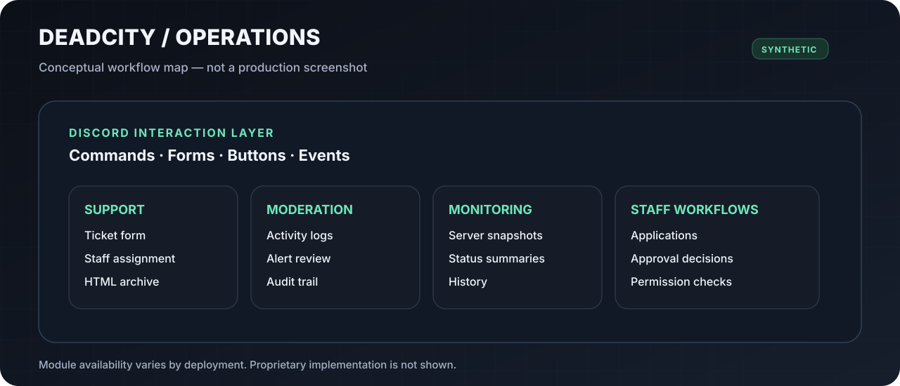
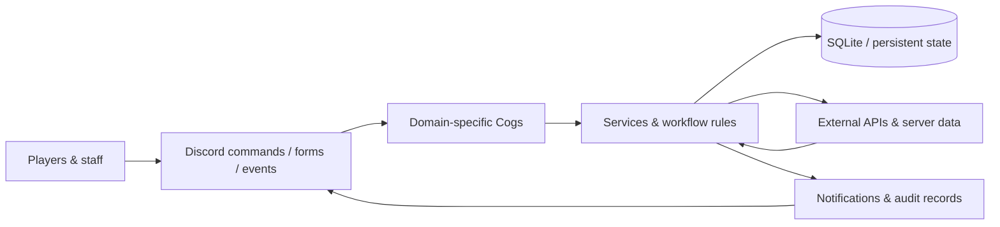

# DeadCity Automation Platform

**Python-powered Discord operations for a DayZ / STALKER roleplay community.**

> **Commercial system · technical case study.** This repository documents selected functionality and implementation decisions. It is **not** a runnable copy of the production application. User data, credentials, server configuration, private detection logic and the full source are excluded.

*Conceptual illustration with fictional labels. Not a production screenshot or disclosure of the private system.*

## The problem

Running a roleplay server involves dozens of repetitive workflows: answering player requests, routing staff reviews, investigating unusual administrative activity and monitoring server availability. Without structured processes, decisions become hard to trace and context gets lost between channels.

DeadCity brings several of these workflows into one Discord-based operational interface, backed by Python services and persistent state.

## What the system covers

| Domain | User-facing workflow | Backend concern |
| :--- | :--- | :--- |
| **Support tickets** | Category-specific forms, staff assignment, ticket status, HTML transcripts | State transitions, permission checks, archival |
| **Moderation & audit** | Forbidden-item and unusual activity alerts with source references | Log parsing, configurable rules, thresholds and deduplication |
| **Staff applications** | Nickname changes, RP questionnaires and review actions | Authorization, reviewer actions and persisted decisions |
| **Server monitoring** | Availability and player/queue reporting | External HTTP calls, retries, snapshot storage and fallback |
| **Access administration** | Priority/access review and related staff workflows | Validation, entitlement lifecycle and external integrations |
| **Community operations** | Temporary voice channels, channel audit and additional member workflows | Discord event handlers, scheduled tasks, configuration |

**Scope note:** Some additional modules exist in the reviewed source snapshot but are not registered in its visible startup entry point. This page does not claim that every module was active in the same deployment.

## Engineering architecture

- **Async interaction layer:** `discord.py` commands, views, buttons and background work.
- **Domain services:** parsing, analysis and storage separated particularly clearly in the player-activity investigation subsystem.
- **Persistence:** SQLite / `aiosqlite` for state and history; selected modules also integrate with MySQL.
- **External integration:** Steam Web API and other private game-server operations.
- **Failure handling:** the server-monitoring client retries failed requests and can retain a last-known successful snapshot.

Read the [architecture notes](docs/ARCHITECTURE.md), [feature overview](docs/FEATURES.md) and [case study](docs/CASE_STUDY.md).

## Verified technical evidence

A private source snapshot supplied for review on **16 November 2026** contained:

| Metric | Reviewed snapshot |
| :--- | ---: |
| Python source files | 48 |
| Approximate Python lines (including tests) | 27,654 |
| Tests in the activity-investigation subsystem | 27 |
| Local result for that subsystem | **27 passed** |

These numbers describe a **reviewed archive, not the complete live deployment**. The 27 tests cover one subsystem; they do not imply that the entire application has equivalent automated test coverage.

## Demonstrated workflows

Available project captures illustrate real Discord interactions for:
- support categories, ticket ownership, staff controls and transcript exports;
- alerts for restricted-item spawning and unusual activity bursts;
- channel creation/deletion audit events;
- nickname-change requests and approval decisions;
- payment verification and other community requests.

Screenshots are available for review separately. Images containing member identifiers, payment details or private staff context should **not** be published without authorization and thorough redaction.

## Technical decisions and trade-offs

**Why Discord as the UI?** Staff already work there, and interactive components make routine requests accessible without building a second control panel.

**Why persistent workflow state?** Staff reviews span multiple interactions; a message alone should not be the source of truth for assignment, status or closure.

**Why a private-source case study?** The system contains proprietary moderation rules, customer-specific integrations and user data. This repository intentionally demonstrates the engineering context without redistributing the production system.

**What I would improve next:** reduce oversized modules, make optional module registration explicit, expand tests beyond log analysis, standardize dependency locking and add more structured error reporting.

## Repository map

- [`docs/ARCHITECTURE.md`](docs/ARCHITECTURE.md) — architecture and data flows
- [`docs/FEATURES.md`](docs/FEATURES.md) — feature overview
- [`docs/CASE_STUDY.md`](docs/CASE_STUDY.md) — problem, approach and engineering outcomes
- [`docs/PRIVATE_SOURCE.md`](docs/PRIVATE_SOURCE.md) — what's intentionally excluded
- [`examples/`](examples/) — **illustrative excerpts, not a deployable application**
- [`SECURITY.md`](SECURITY.md) — security and disclosure policy

## Contact

**Scumbagsss** — Python Backend · Automation · Discord Integrations

**Contact:** Discord — `scumbagsss` · Telegram — [@dilarion](https://t.me/dilarion).

*Project material should only be published with the relevant owner's authorization. No unpublished credentials, configuration, databases or player records are included here.*
