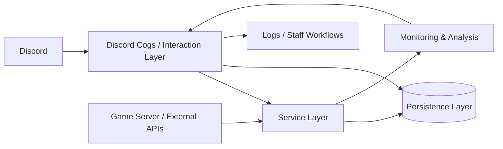

# DeadCity Bot — Portfolio Showcase

> A private production Discord automation system for a DayZ / STALKER RP community, presented here as a **non-runnable portfolio showcase**.


**DeadCity Bot** is a multi-module Discord application built to automate community operations, monitoring, moderation workflows and game-server integrations.

This repository intentionally contains **documentation and selected code excerpts only**. The production source, runtime configuration and proprietary modules remain private.

## Highlights

- **Game server monitoring** — status, player count, queue, history and activity data.
- **Ticket workflows** — configurable categories, staff controls, archive flow and HTML transcripts.
- **Discord audit logging** — member, message, voice, role and nickname events.
- **Role & nickname automation** — role-based prefixes and moderated nickname requests.
- **Temporary voice channels** — automatic creation, ownership and cleanup.
- **Faction reservation workflows** — interactive community-management flows.
- **Priority access & feedback systems** — configurable member workflows.
- **Spawn / abuse monitoring** — private detection modules and staff alerts.
- **Duplicate-event analysis** — parser, confidence scoring, persistent cases and automated tests.

## Tech stack

`Python` · `discord.py` · `asyncio` · `SQLite / aiosqlite` · `REST APIs` · `Steam Web API` · `matplotlib` · `JSON/JSONC`

## Architecture



The production application is split into independent domains instead of one large bot file. Discord-facing cogs call service/domain components, while persistence and configuration are isolated behind their own layers.

More detail: [`docs/ARCHITECTURE.md`](docs/ARCHITECTURE.md)

## Repository contents

```text
deadcity-discord-bot-showcase/
├── README.md
├── LICENSE
├── SECURITY.md
├── docs/
│   ├── ARCHITECTURE.md
│   ├── FEATURES.md
│   └── PRIVATE_SOURCE.md
├── examples/
│   ├── cog_pattern.py
│   ├── snapshot_model.py
│   └── storage_pattern.py
    └── README.md
```

There is deliberately **no executable entry point**, production configuration, token loader, API credential handling, complete database schema or full feature implementation in this repository.

## Selected code excerpts

The `examples/` directory contains small, isolated excerpts that demonstrate coding style and architectural patterns without publishing enough source to deploy or reconstruct the production bot.

### Async Discord component

```python
class StatusCog(commands.Cog):
    def __init__(self, bot, status_service):
        self.bot = bot
        self.status_service = status_service

    @app_commands.command(name="server_status")
    async def server_status(self, interaction: discord.Interaction) -> None:
        snapshot = await self.status_service.get_public_snapshot()
        await interaction.response.send_message(
            embed=build_status_embed(snapshot),
            ephemeral=True,
        )
```

The production implementation contains additional permissions, caching, error handling, configuration and domain logic that are not included here.

## Why the source is private

DeadCity Bot was built as a real community system rather than an open-source template. Publishing the complete repository would make it possible to clone and redeploy the application and would expose proprietary moderation/detection logic.

For that reason:

- production source code is stored privately;
- credentials and real Discord IDs are never included here;
- detector implementations and business rules are not published;
- database schemas shown publicly are reduced examples;
- screenshots/documentation can demonstrate the product without distributing it.

See [`docs/PRIVATE_SOURCE.md`](docs/PRIVATE_SOURCE.md).

## Screenshots / demo

Add screenshots of the bot **from Discord** to `screenshots/` after hiding personal data, Discord IDs, webhook URLs, tokens, internal staff channels and anything else that should stay private.

Good screenshots to add:

1. Server-status embed
2. Ticket panel / ticket workflow
3. Moderation or audit log embed
4. Faction/priority workflow
5. A graph or monitoring report

## Security

No production secrets belong in this repository. If a credential was ever exposed anywhere outside your private environment, rotate it before continuing to use it.

See [`SECURITY.md`](SECURITY.md).

## Source-use notice

This is a portfolio/evaluation repository, **not an open-source distribution**. No permission is granted to copy, redistribute, rebrand, resell or commercially reuse the code excerpts or project materials except where required by applicable law.

See [`LICENSE`](LICENSE).

## Author

**Scumbagsss**  
Python Developer · Discord Bot Developer · Automation
