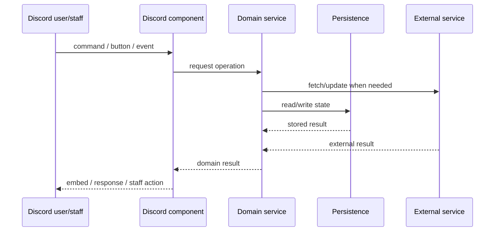

# Architecture

This document describes the **public high-level architecture only**. Internal implementation details are intentionally omitted.

## Design goals

The production bot was structured around several goals:

- keep Discord UI/interaction code separate from business logic;
- isolate external API access;
- centralize persistence instead of embedding SQL in every command;
- keep long-running monitoring tasks asynchronous;
- make major community features independent enough to evolve separately;
- keep production configuration and secrets outside source control.

## High-level layers

### 1. Discord interaction layer

Responsible for slash commands, buttons, modals, embeds, permission checks and event handlers.

Examples of domains represented here include tickets, nickname workflows, role automation, radio/voice management and staff tools.

### 2. Service/domain layer

Contains non-Discord business logic such as server status processing, external API integration, report generation and analysis workflows.

Discord components should request results from services rather than knowing how external systems work internally.

### 3. Persistence layer

Stores runtime state, snapshots, workflow state and selected historical information.

The production schema is private. Public examples show only generic repository patterns.

### 4. Monitoring / analysis

Long-running asynchronous jobs observe external data, normalize events and generate staff-facing results.

Detector thresholds, correlation rules and anti-abuse logic are proprietary and are not published in this showcase.

## Simplified data flow

## What is intentionally absent

The public repository does not include:

- the production bot entry point;
- complete cogs/modules;
- detector algorithms;
- production SQL schema;
- runtime configuration loader;
- token/API key handling;
- real server, channel, role or user IDs;
- deployment scripts;
- private test fixtures or production logs.
