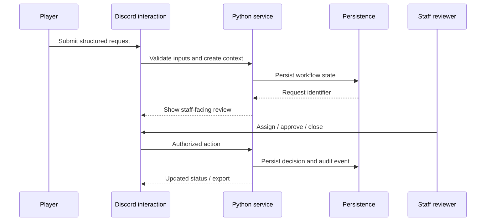

# DeadCity — technical review and improvement roadmap

> **Scope:** a private source archive and Discord screenshots supplied for portfolio review on **16 November 2026**. This is not an independent live-environment audit. The repository does not publish production source or records.

## What was verified

| Observation in reviewed archive | Scope and limitation |
|---|---|
| 48 Python source files, approximately 27,654 lines including tests | Snapshot only; neither deployment size nor author attribution is independently verified |
| 27 passing tests under a player-activity investigation suite | **Subsystem-only** local result; not whole-platform coverage |
| 11 Cogs and 2 extensions directly registered by the inspected entry point | Other files exist, but their activation in live deployments is not established |
| Separate parsing, analysis, models, persistence and case-processing modules in the investigation subsystem | A real example of service separation within the reviewed snapshot |
| Steam server client with retry and last-known-good snapshot handling | Consumers still need a clear fresh/stale signal |
| Screenshots of ticket review, activity alerts, channel audit and transcript export | Demonstrate UI behavior, not independently measured uptime or traffic |

## Workflow boundaries

*This diagram illustrates system responsibilities. It is not a verbatim transcript of production implementation or a promise that every optional module is active.*

## Engineering strengths

**Meaningful domain complexity.** The project coordinates support cases, moderation signals, review decisions and server data in a common interaction surface.

**Asynchronous application design.** The reviewed bot uses Discord Cogs and background work. Asynchronous integration is appropriate for event-driven interactions, though it requires robust error handling and shutdown behavior.

**Tested investigation logic.** The player-activity package has separation between processing stages and a specific test suite. This is a stronger engineering signal than publishing unimplemented interface stubs alone.

## Proposed improvements (not implemented in the public case study)

| Priority | Observed concern | Recommended engineering action | How to verify |
|---|---|---|---|
| P0 | Source archive included operational config, data and logs | Keep public showcase isolated from real runtime; rotate any inadvertently exposed credentials | Secret scan and manual publication review |
| P1 | Some modules are present but not directly registered at startup | Explicit module registry and startup diagnostics | Test expected enabled modules for each configuration |
| P1 | Several files exceed 2,000 lines | Incremental service/view extraction, protected by characterization tests | Behavior-preserving regression suite |
| P2 | Dependency declaration is not fully reproducible; one async HTTP dependency was imported transitively | Explicit dependencies, pinned test environment and CI | Fresh-environment install and smoke test |
| P2 | Top-level command error handling is sparse | User-safe errors and structured diagnostics | Invalid-input, API-failure and restart tests |
| P2 | Cached server status may look fresh if callers ignore its age | Expose last-success timestamp and stale-data indicator | Simulate API outage and assert stale metadata |
| P2 | Tests primarily cover one subsystem | Add synthetic ticket, priority, permission and registration tests | Unit and integration test matrix |

These are improvement opportunities identified in the supplied snapshot—not claims that the private production system is defective in its current deployment.

## Suggested refactor sequence

1. Establish a **module inventory**: actively registered, optional and unused modules.
2. Add characterization tests around one complete workflow before editing its internals.
3. Move database actions and external API adapters out of Discord views, one feature at a time.
4. Introduce typed service inputs/outputs, structured error categories and a consistent logging format.
5. Add CI against synthetic fixtures, then validate behavior in a staging deployment.
6. Document known limitations and ensure configuration never flows into public artifacts.

A wholesale rewrite is not recommended without a baseline test suite.

## Review boundaries

No production algorithms, SQL schemas, API credentials, Discord identifiers, internal monitoring thresholds or private player data are published here. All visuals in this repository are conceptual, unless explicitly labeled as approved and redacted real screenshots.

**Public runnable references:** [ticket backend demo](https://github.com/Scumbagsss/advanced-discord-ticket-bot), [monitoring data demo](https://github.com/Scumbagsss/dayz-server-monitor-bot), [FastAPI workflow demo](https://github.com/Scumbagsss/priority-access-bot).
